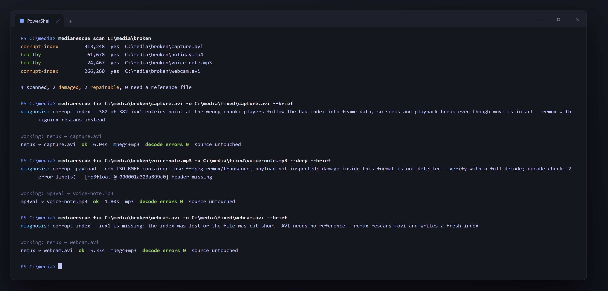
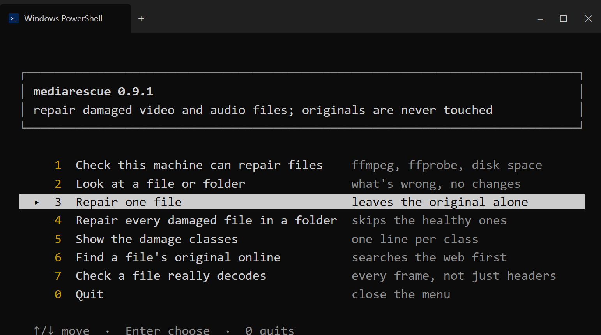
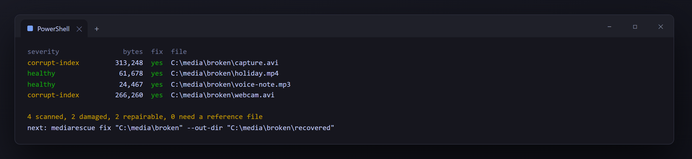

# mediarescue

[](https://github.com/lutherrio25-svg/mediarescue/pkgs/container/mediarescue)
[](https://github.com/lutherrio25-svg/mediarescue/releases)
[](https://github.com/lutherrio25-svg/mediarescue/actions/workflows/tests.yml)
[](LICENSE)

Diagnose and repair damaged audio/video files from the command line. It tells you what is
wrong with a file, repairs it into a **new** file, and reports exactly what it had to give up.

**Originals are never modified.** Nothing is overwritten, nothing is deleted.

Built for the failures that actually show up on a real disk: interrupted copies, zero-filled
heads, fragmented MP4s that lost their init segment, downloads that never finished.



The screenshot is a real session: `scan` on a folder holding one healthy MP4, one AVI whose
`idx1` points at the wrong chunks, one AVI whose index was cut off, and an MP3 damaged mid-file.
Each repair below it is the CLI's own output, unedited.

## Install

```bash
pip install "git+https://github.com/lutherrio25-svg/mediarescue.git"
```

Requires Python 3.10+ and `ffmpeg` + `ffprobe` on your `PATH`:

| Platform | Command |
|---|---|
| Windows | `winget install --id Gyan.FFmpeg -e` |
| macOS | `brew install ffmpeg` |
| Debian/Ubuntu | `sudo apt install ffmpeg` |

`winget` only updates `PATH` for **new** shells, so close the terminal and open a fresh one.
Confirm with `ffmpeg -version` and `mediarescue --version`. If ffmpeg lives somewhere unusual,
point at it with `MEDIARESCUE_FFMPEG` / `MEDIARESCUE_FFPROBE`.

`pip: command not found` means Python itself is missing (on Windows the `python` in `WindowsApps`
is only a Microsoft Store stub). Install it first, then reopen the terminal:

| Platform | Command |
|---|---|
| Windows | `winget install -e --id Python.Python.3.12` |
| macOS | `brew install python` |
| Debian/Ubuntu | `sudo apt install python3 python3-pip python3-venv` |

A virtual environment keeps the tool out of the system Python, and puts a `mediarescue` command in
its `Scripts` (Windows) or `bin` (macOS/Linux) folder:

```bash
python -m venv ~/mediarescue-cli
~/mediarescue-cli/Scripts/pip install "git+https://github.com/lutherrio25-svg/mediarescue.git"   # Windows
~/mediarescue-cli/bin/pip    install "git+https://github.com/lutherrio25-svg/mediarescue.git"   # macOS/Linux
```

No Python on the machine? The published container already has ffmpeg inside:

```bash
docker run --rm -v "D:/broken:/media" ghcr.io/lutherrio25-svg/mediarescue:latest scan /media
```

Optional extra: put [`mp3val`](https://mp3val.sourceforge.net) on `PATH` (or set
`MEDIARESCUE_MP3VAL`) and `fix` will rebuild damaged MP3 frame streams instead of only
rewriting the container. Without it the tool still runs and says the damage was left alone.

Or just ask the tool itself:

```bash
mediarescue doctor
```

```
mediarescue 0.5.2 — doctor

  ok    python        3.14.9
  ok    ffmpeg        ffmpeg version N-127043-g5a54fcf75e-20260930
  ok    ffprobe       ffprobe version N-127043-g5a54fcf75e-20260930
  opt   mp3val        not installed — damaged MP3 frame streams can be rebuilt
                      -> download mp3val, or set MEDIARESCUE_MP3VAL to its path
  ok    write access  C:\Users\you\Documents\mediarescue
  ok    disk space    49.8 GB free

ready: everything this tool needs is present
```

`opt` marks an optional helper: the tool is ready without it, it just repairs fewer formats.
Anything *required* that is missing is printed as `FAIL` together with the command that fixes
it, and the exit code is 1.

The `write access` line checks the folder you are standing in, and a read-only one is not a
problem — Git Bash opened from the Start menu sits in `C:\Program Files\Git`, and the tool still
writes every repaired copy beside the original. Pass `--workdir D:/fixed` only when you want the
check to test a specific folder.

## All-in-one menu

No flags to remember: run `mediarescue` with no arguments in a terminal and you get a menu.



```
┌────────────────────────────────────────────────────────────────────────┐
│ mediarescue 0.5.0                                                      │
│ repair damaged video and audio files; originals are never touched      │
└────────────────────────────────────────────────────────────────────────┘

     1  Check this machine can repair files    verifies ffmpeg, ffprobe, disk space
     2  Look at a file or folder               says what is wrong; changes nothing
  ▶  3  Repair one file                        writes a new file, original untouched
     4  Repair every damaged file in a folder  skips the healthy ones, repairs the rest
     5  Show the damage classes and what each repair does
     0  Quit                                   close the menu

  ↑/↓ move · Enter choose · 0 quits
```

Use the arrow keys and press Enter, or just type the number and press Enter — whichever you
prefer. Every row says what it does in plain words, so you never have to guess what "scan" or
"fix" means. Each choice asks for the path it needs and then runs the same command you would have
typed: the menu calls the CLI, it does not re-implement it, so the two can never disagree.

`mediarescue menu` opens it explicitly. From a script (stdin or stdout not a terminal) a bare
`mediarescue` prints the help and exits 2 instead of waiting for input, so nothing ever hangs.
On a legacy console code page the frame falls back to `+ - |` characters instead of crashing.

## Quick start

Three commands, in order.

**1. Find out what is broken.** Point it at a file or a whole folder:

```bash
mediarescue scan "D:/broken-file"
```

```
severity                bytes  fix  file
corrupt-index         313,248  yes  C:\broken-file\clip.avi
healthy                61,678  yes  C:\broken-file\holiday.mp4
corrupt-index         266,260  yes  C:\broken-file\webcam.avi

3 scanned, 2 damaged, 2 repairable, 0 need a reference file
next: mediarescue fix "C:\broken-file" --out-dir "C:\broken-file\recovered"
```

Read it left to right: what is wrong, how big, whether it can be rebuilt (`fix` = yes/no, coloured
green or red in a terminal), and which file. The last line tells you the exact command to run next,
with your own path already filled in. Add `--out report.json` to keep the full details.



That reads headers only. Add `--deep` to decode every file as well — slower, but it is the only
way to catch damage inside MP3/MKV/AVI, or a junk payload hiding behind a perfect index:

```bash
mediarescue scan "D:/broken-file" --deep
mediarescue scan "D:/broken-file" --deep --deep-seconds 30   # quick pass, opening 30s each
```

**2. Repair the damaged file.** Leave the strategy on `auto` — it is chosen from the scan
result:
```bash
mediarescue fix "D:/broken-file/clip.mp4" -o "D:/fixed/clip.mp4"
```

You get one diagnosis line, then JSON saying what it did:

```
diagnosis: missing-trailer — mdat declares 26,383,400 bytes but file is 18,530,556;
           moov sits inside that dead range at 18,407,240 — trim mdat to expose it
{
  "ok": true,
  "output": "D:/fixed/clip.mp4",
  "notes": [
    "mdat header trimmed: 7,976,192 declared bytes were never written to disk",
    "dropped the first 14.000s: 339 unreadable samples before the first clean IDR at sample #350"
  ],
  "dropped_seconds": 14.0,
  "strategy": "salvage"
}
```

Read `notes` and `dropped_seconds` — that is the honest part. If it reports 14 seconds dropped,
your repaired video starts 14 seconds in, because that head was unreadable garbage.

The JSON also carries `verify`: the repaired file is decoded and `decode_errors` must be `0`. A
repair that writes a file but leaves broken payload exits with `1`, because a playable container
full of silence is not a fix. Add `--deep` to decode the *input* first (same check as
`scan --deep`), or `--no-verify` to skip the check on the output.

**Repairing a whole folder** works the same way — point `fix` at it. Damaged files are repaired,
healthy ones are left untouched, and the exit code is `1` if anything failed:

```bash
mediarescue fix "D:/broken-file" --out-dir "D:/fixed"
```

```
  fixed   big_mdat.mp4                     salvage
  ok      holiday.mp4                      healthy, left untouched
  skip    empty.mp4                        empty: nothing to rebuild from
  FAILED  fragment.mp4                     the stream carries no SPS/PPS (NAL 7/8) …

4 files: 1 repaired, 1 failed, 2 skipped
```

**3. Prove the repair.** `ffprobe` reads headers, so a file can look perfect and still be noise
inside. A full decode is the real test — **silence means it worked**:

```bash
ffmpeg -v error -i "D:/fixed/clip.mp4" -f null -
```

Nothing printed means the frames really decode. Then open the file and look at it.

## Which command do I need?

| What you see | Run this |
|---|---|
| Not sure what is wrong | `mediarescue scan <file-or-folder>` |
| File will not open or play at all | `mediarescue fix broken.mp4 -o fixed.mp4` |
| Plays, but freezes or shows coloured blocks | `mediarescue fix broken.mp4 -o fixed.mp4` |
| Starts mid-scene, first seconds are garbage | `mediarescue fix broken.mp4 -o fixed.mp4` (`auto` picks `salvage`) |
| Video plays, audio clicks or drops out | run the decode check first; audio payload that is gone cannot be invented |
| File is 0 bytes | nothing to recover — re-download or restore a backup |
| Everything already looks fine | `mediarescue fix good.mp4 -o copy.mp4` rewrites the container cleanly |

## The one thing that trips everyone up: `--reference`

Two damage classes — `fragmented` and `missing-atoms` — mean the file lost the index that says
*where each frame starts*. That index cannot be guessed back, so the tool needs a second,
undamaged file to borrow the layout from:

```bash
mediarescue fix dash-segment.mp4 --reference intact.mp4 -o fixed.mp4
```

What counts as a good reference:

- an **intact file from the same app, camera or recorder** — same settings, ideally the same
  session
- the **video codec must match**. A fragmented AV1 file can borrow structure from an H.264
  file, but a source that is itself H.264 needs an H.264 reference, or it is refused instead
  of producing garbage
- it does not have to be the same video — anything that opens and plays normally will do

No reference anywhere? The tool looks for one itself: a healthy file **in the same folder** whose
video codec matches is picked automatically, and the choice is reported in the output
(`"reference": "…"`). Only when that fails does it fall back to `--strategy carve`.

## When the intact file is online instead of on your disk

The twin of a damaged download often still lives in a free cloud drive. `--reference` accepts a
**share link** as well as a path, downloads it to a temporary folder, uses it, and deletes it when
the run ends:

```bash
mediarescue fix "D:/file-rusak/bad-block" --out-dir "D:/file-rusak/recovered" \
  --reference "https://terabox.com/s/1AbCdEfGhIjKl"
```

Supported links:

| Host | What to paste |
|---|---|
| **TeraBox** (and its mirror domains) | the normal share link, `.../s/<id>` or `.../sharing/<id>` |
| MediaFire, pixeldrain, GoFile | the share link as it is |
| Google Drive | `Share → copy link`; the file can stay private-if-link |
| Dropbox / OneDrive | the share link; `?dl=0`/`?download=0` is rewritten to a download |
| anything else | a direct `http(s)` link to the file itself |

Notes that save a support round-trip:

- **Mega is refused** — its links are decrypted inside the browser, so download it yourself and
  pass the local file instead.
- TeraBox shares that are folders are fine: the **largest video** in the share is used, since a
  reference says nothing about *which* video it is, only how it was encoded.
- If TeraBox asks for a logged-in session, copy that page's `Cookie` header into the environment
  variable `MEDIARESCUE_TERABOX_COOKIE` and run again. Cookies expire; refresh when it complains.
- A share link that returns a sign-in page instead of a file is reported as exactly that, never
  saved as a fake reference.
- Downloads are capped at 4 GB: anything larger is not a reference, it is a mistake.

## When it cannot be fixed

This is a repair tool, not a magic wand:

- overwritten or zero-filled data is **gone**. No tool can invent frames that were never
  written; re-download or restore from backup
- a dropped head stays dropped — `salvage` reports the seconds instead of faking them
- audio packets lost in the middle cannot be reconstructed; the file plays with gaps
- it works on existing files only. Carving files off a raw disk is a different job (PhotoRec)

## Reference

### Damage classes

| Severity | Meaning | Strategy | Needs reference |
|---|---|---|---|
| `healthy` | boxes parse, index reachable | `remux` (optional cleanup) | no |
| `corrupt-payload` | index is perfect but the first video sample does not parse (head overwritten) | `salvage` | no |
| `missing-trailer` | `mdat` runs past EOF, hiding a valid `moov`; truncated PNG/JPEG | `salvage` (trim, then cut a junk head) | no |
| `fragmented` | starts at `moof`/`mdat`, init segment lost | `flatten` (or `carve` without a reference) | yes |
| `missing-atoms` | `ftyp`+`mdat` present, `moov` gone | `graft` (or `carve` without a reference) | yes |
| `corrupt-index` | AVI: `idx1` missing, or its entries point past the chunk they name | `remux` with `+ignidx` | no |
| `headerless` | no parsable box, large zero regions | not repairable locally | — |
| `empty` | 0 bytes | not repairable | — |

### Strategies

- **remux** — `ffmpeg -c copy` container rewrite with corrupt-packet tolerance.
- **trim** — shrink an oversized `mdat` header to the real payload so the trailing `moov`
  becomes reachable again, then remux. No re-encode.
- **graft** — keep the damaged `mdat`, graft the reference `moov`, rewrite every
  `stco`/`co64` chunk offset by the position delta. Refuses on overflow or when the reference
  has no usable sample table.
- **flatten** — parse `tfhd`/`trun` from every fragment, rebuild `stts`/`ctts`/`stsc`/`stsz`/
  `stco`/`stss`, and emit a normal non-fragmented MP4. The codec is sniffed from the sample
  bytes: **AV1** gets an `av01`/`av1C` entry built from the stream's own sequence header (no
  reference codec is borrowed); **H.264** reuses the reference's `avcC`, and a reference with a
  different video codec is refused instead of producing garbage. Audio timescale is inferred
  from sample durations. Samples past EOF from a truncated final fragment are dropped and
  counted, not fatal.
- **salvage** — for a file whose *head* was overwritten (a resume that landed at the wrong
  offset, a copy that mixed two files). Trims an oversized `mdat`, then walks the sample table
  to find the first video sample that really starts a picture — an H.264 IDR, or an AV1
  `KEY_FRAME` — and stream-copies from that timestamp. The cut is reported, so you know exactly
  how much was lost and how much is bit-identical. Nothing is re-encoded, and the corrupt head is
  dropped rather than concealed — a frozen frame over dead data helps nobody.
- **carve** — the last resort when the index is gone *and* there is no reference file: walk the
  raw `mdat` for length-prefixed NAL units, rebuild an Annex-B stream and let ffmpeg write a
  fresh index. It needs two things the file may not have: **SPS/PPS in-band** (encoders usually
  keep them in the lost `avcC`, so streams made with `repeat-headers=1` are the ones that work)
  and **contiguous video samples** (samples interleaved one-per-chunk cannot be delimited without
  the index). It recovers **video only**, and the frame rate is assumed — pass `--fps` to correct
  it. When either condition fails it says so instead of writing a file that looks fine.

Force one explicitly with `--strategy trim|remux|graft|flatten|salvage|carve`. If audio and video
durations still disagree after a `flatten`, give every track one clock with `--timescale 90000`.

```bash
# No index and no reference file: rebuild what the payload still holds
mediarescue fix damaged.mp4 -o rebuilt.mp4 --strategy carve --fps 30
```

### Honest limits

- A reference must match the recording's codec configuration; a wrong one yields a file that
  probes fine but decodes wrong. Always eyeball the result.
- `ffprobe` reads headers, not pictures. Prove a repair with the full decode from step 3 and
  require **zero** output lines.
- `corrupt-payload` is decided by parsing the first video sample: H.264 must tile as
  length-prefixed NALs, AV1 must frame as OBUs. Anything else counts as junk.
- Damage inside **MP3, WAV, FLAC, OGG, AAC, MKA, MKV, AVI, GIF and WEBP is not inspected by the
  header scan**: those containers are reported as `healthy` as soon as they are readable, so a
  file with a mangled middle still scans clean. `scan --deep` catches it by decoding, and
  `fix --deep` applies the same check to the input.
- AV1 is cut at its own KEY_FRAME now, but a damaged AV1 head is only recoverable when a later
  keyframe exists **and** the sequence header travels in-band; otherwise nothing can decode it.
- `carve` works only when SPS/PPS travel in-band and video samples are contiguous; it recovers
  video without audio and assumes the frame rate. Everything else it refuses, with the reason.
- Automatic reference selection looks at the **same folder, its sub-folders and one level up**
  (capped at 40 candidates). Point `--reference` explicitly when the intact file lives further
  away.

### Sources

Format specs and prior art this tool is built on:

- **ISO Base Media File Format** (ISO/IEC 14496-12) and **CMAF** (ISO/IEC 23000-19) — box layout, `moof`/`traf`/`trun` fragments. Paid standards, no free link.
- [AOMedia AV1 Bitstream & Decoding Process Specification](https://aomediacodec.github.io/av1-spec/) — OBU framing (section 5.5), sequence-header parsing and the `av1C` fields `flatten` writes.
- [ITU-T H.264 (free copy)](https://www.itu.int/rec/T-REC-H.264) — NAL unit types, IDR frames, SPS/PPS, and the length-prefixed sample layout `carve` walks.
- **ISO/IEC 14496-3** — AAC `AudioSpecificConfig` carried inside `esds`. Paid standard, no free link.
- **ISO/IEC 11172-3** — MPEG-1 Audio Layer III frame header and the Xing/Info tag that `mp3val` rebuilds. Paid standard, no free link.
- [Apple QuickTime File Format](https://developer.apple.com/documentation/quicktime-file-format) — free reference for `moov`, `stbl`, `stco`/`co64`, `stsz`, `stts`, `edts`.
- [MP4 Registration Authority](https://mp4ra.org/) — registered box, codec and `ftyp` brand identifiers.
- [FFmpeg formats docs](https://ffmpeg.org/ffmpeg-formats.html), [`libavformat/mov.c`](https://github.com/FFmpeg/FFmpeg/blob/master/libavformat/mov.c) and [`libavformat/avidec.c`](https://github.com/FFmpeg/FFmpeg/blob/master/libavformat/avidec.c) — how a real demuxer reads these boxes and how it resolves `idx1` offsets (the two bases `avi.check` tries), and why it rejects the files here.
- [Matroska / EBML specification](https://www.matroska.org/technical/specs/index.html) — what `scan --deep` can and cannot conclude about an MKV.
- [RFC 8216 (HLS)](https://datatracker.ietf.org/doc/html/rfc8216) — why fragmented MP4 segments arrive without `ftyp`/`moov`, the `fragmented` class.
- [PNG specification (W3C)](https://www.w3.org/TR/png/) — signature and `IEND` check.
- [JPEG, ITU-T T.81 (W3C copy)](https://www.w3.org/Graphics/JPEG/itu-t81.pdf) — SOI/EOI markers.
- [Microsoft AVI RIFF File Reference](https://learn.microsoft.com/en-us/windows/win32/directshow/avi-riff-file-reference) — `LIST movi` chunk chain, the `idx1` entry layout and what its offsets are relative to; the basis of `avi.check`.
- [mp3val](https://mp3val.sourceforge.net/) — the MPEG frame/Xing-header validator that `fix` drives for damaged MP3s.
- [MKVToolNix](https://mkvtoolnix.download/) — `mkvmerge`'s remux behaviour, the reference for what container rewriting can and cannot repair.
- [DivFix++](https://www.divfix.org/) — the long-standing AVI index rebuilder; its approach is what `corrupt-index` now does internally.
- [untrunc](https://github.com/anthwlock/untrunc) (fork of [ponchio/untrunc](https://github.com/ponchio/untrunc)) — the established reference-based MP4 repair tool, and the build that was measured against `flatten`; it handles more codecs than the original.
- [PhotoRec](https://www.cgsecurity.org/wiki/PhotoRec) — for carving files from a raw disk, which this tool does not do.

### Development

```bash
pip install -e .[dev]
python -m pytest                    # fixtures are generated with ffmpeg; those tests skip without it
python scripts/acceptance_check.py  # drives an installed CLI end to end, exit codes included
python scripts/fuzz_check.py        # damages 7 file types 10 ways each; any traceback or false "fixed" fails
```

See [CHANGELOG.md](CHANGELOG.md) for what changed between versions, and
[docs/related-tools.md](docs/related-tools.md) for the other repair tools that were measured
against this one — including the gaps they cover better.

MIT licensed.
